# SVAN M2 – quadruped simulation in a digital twin of our college lab

ROS Noetic + Gazebo 11 work on the **SVAN M2** quadruped (xTerra Robotics) in our college robotics lab.
I rebuilt the lab as a Gazebo world from photos. One launch file brings up the robot in that world, ready to drive. On top of that I wrote
closed-loop autonomy (pure-pursuit laps around the conference table with automatic fall/stuck recovery),
follow cameras, and tools that measure the gait.

<p align="center">
  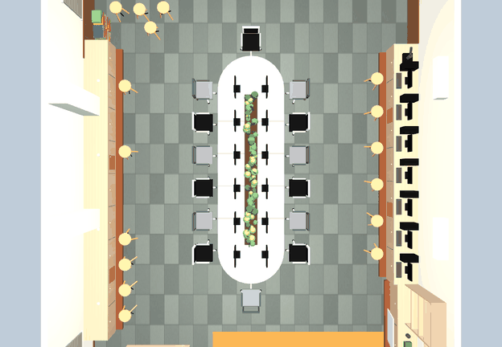<br>
  <em>One autonomous lap around the conference table (top view, sped up)</em>
</p>

| Chase cam | Planned path vs. what the robot really walked |
|---|---|
| 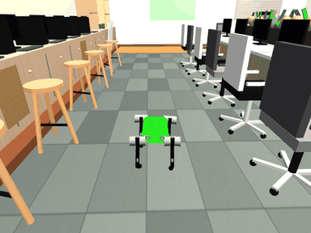 | 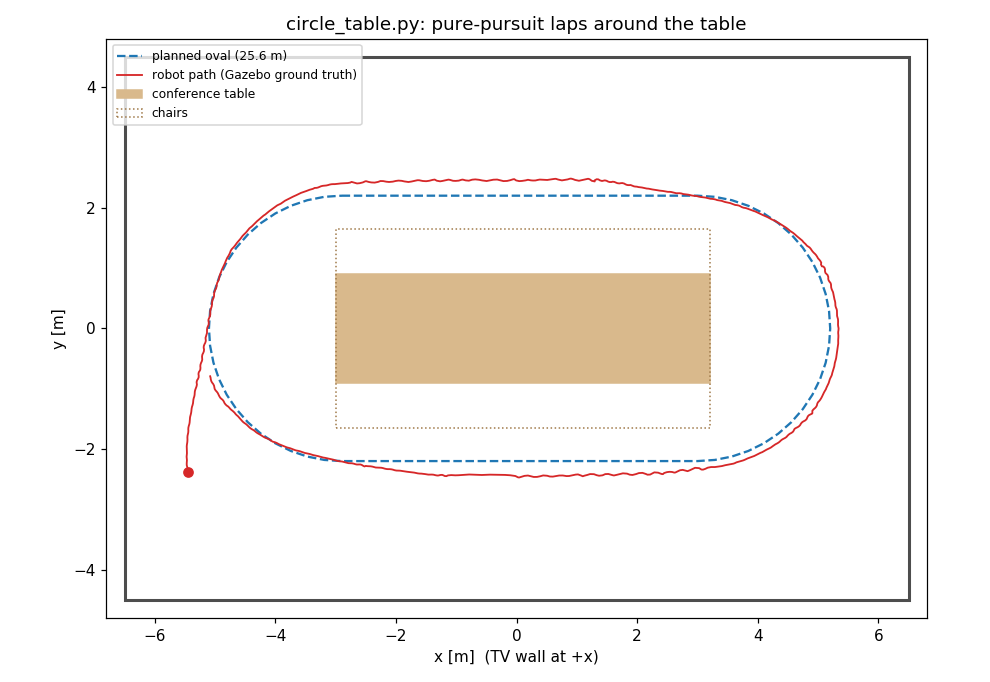 |

---

## What I built

| | |
|---|---|
| **Lab digital twin** | `generate_lab_world.py` turns measurements from 15 photos of the real lab into a Gazebo world, with procedural textures, solid furniture, lights, TV, podium and orange mat. |
| **One-command bring-up** | `lab_sim.launch` starts the world, spawns SVAN, the PD joint controller, the motor-command publisher, keyboard teleop and camera windows. |
| **Follow cameras** | `camera_views.py` spawns invisible camera models and moves them with the robot every tick, giving bird's-eye, robot POV and chase views without touching the robot's URDF. |
| **Autonomous table laps** | `circle_table.py` steers SVAN around a 25.6 m oval with pure pursuit on ground-truth pose. It slows down before curves, counts laps, and recovers by itself if the robot falls or gets stuck. |
| **Fall recovery** | `reset_robot.py` pauses physics, puts the robot upright, holds it in the air until the legs fold into stance, then sets it down. |
| **Command API** | `svan_cmd.py` wraps the 9-float `/svan/io_interface` protocol in a small Python class: `Svan().walk(...)`, `.stop()`, `.pose()`. |
| **Gait characterisation** | Measured how the commands map to real speed and turning radius. The results drove the path design (see [Engineering notes](#engineering-notes)). |

## Real lab vs. simulation

| Real lab (photo) | Gazebo world |
|---|---|
| 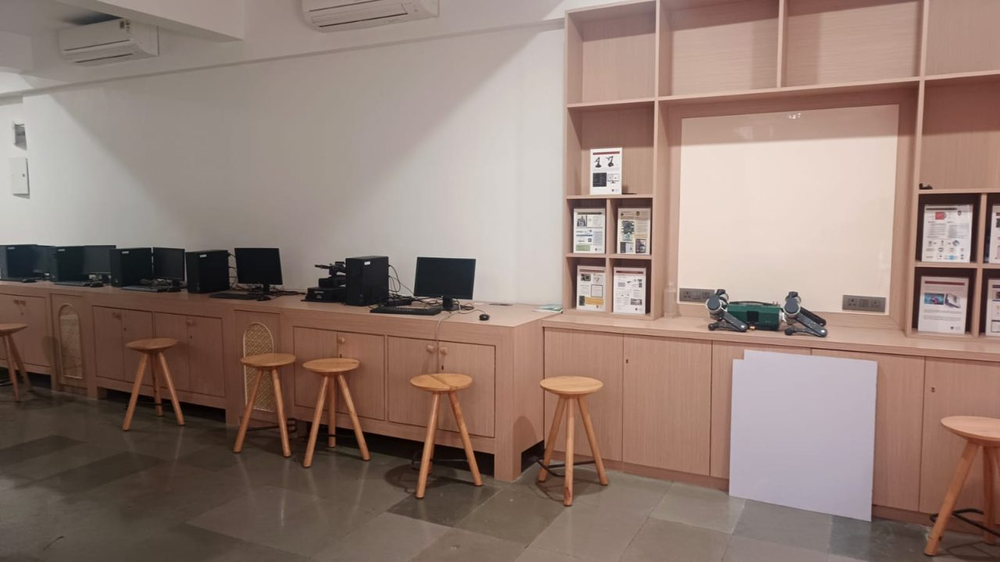 | 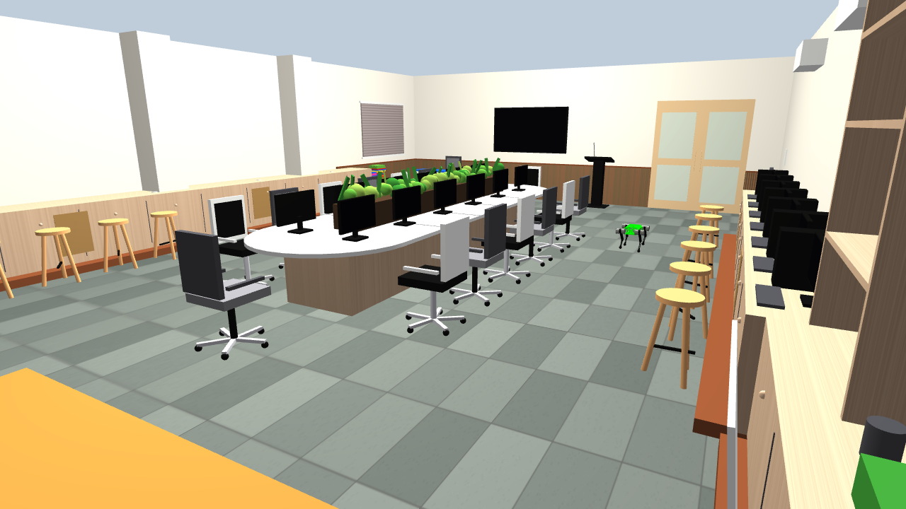 |
| 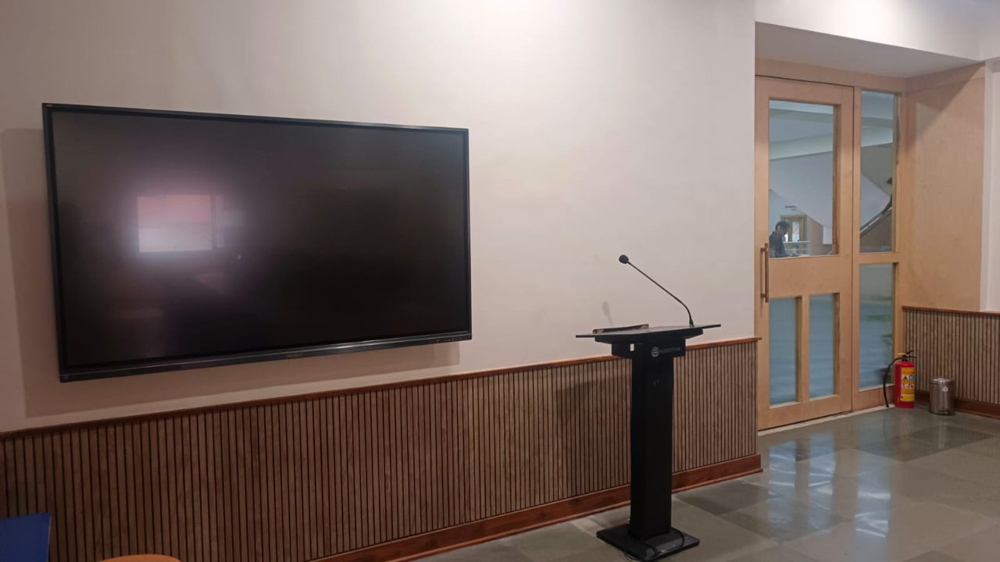 | 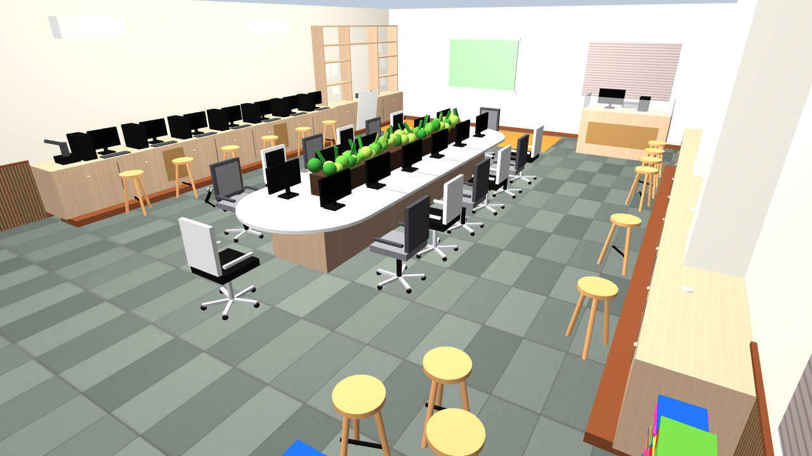 |

All 15 reference photos are in [`docs/lab_photos/`](docs/lab_photos). The room is about 13 × 9 m, scaled from the 0.6 m floor tiles.
Furniture is solid, so the robot can bump into and trip over things just as it would in the real lab.

### The robot's own views (from `camera_views.py`)

| Bird's eye | Robot POV | Chase |
|---|---|---|
| 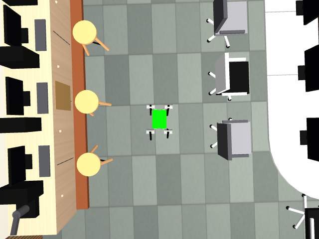 | 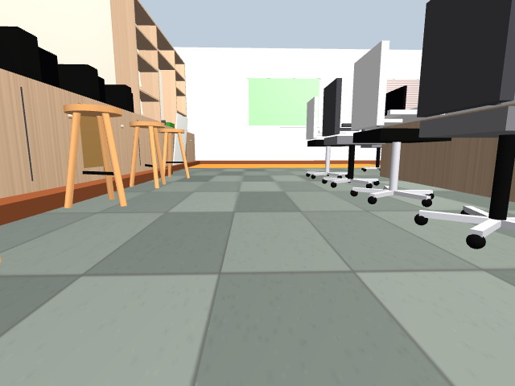 | 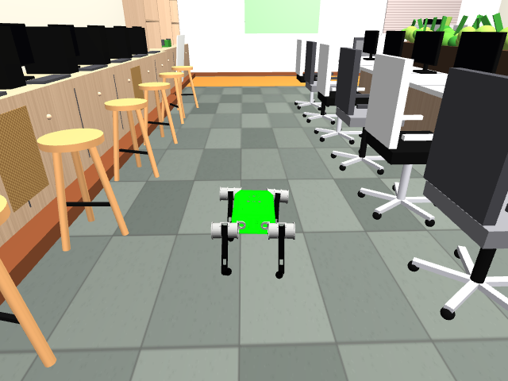 |

---

## Architecture

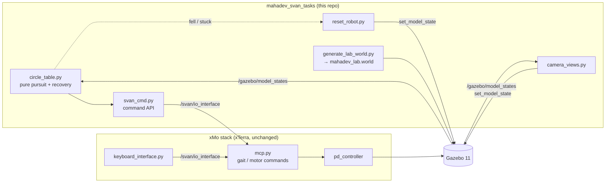

The vendor stack is used as is. All of my work sits in its own package and talks to it only through
ROS topics and services. The same `svan_cmd.py` commands drive the real robot too, because `mcp.py` runs on it.

---

## Engineering notes

**1. The "yaw" command is not a turn rate.**
Reading `mcp.py` showed that the yaw input only adds a small body twist (`YAW_CORRECTION_SCALE = 0.1 rad`).
So SVAN **cannot turn on the spot**; it turns only while it trots. My first waypoint path had sharp corners, and the robot
got stuck on the chair at the table's end. I replaced that path with a stadium-shaped oval whose round ends fit the turning radius
the robot can actually reach.

**2. Measured gait (Gazebo, open floor):**

| forward command | speed | turning radius at full yaw |
|---|---|---|
| 0.2 | ~0.12 m/s | ~1.5 m |
| 0.3 | ~0.22 m/s | ~1.8 m |
| 0.4 | — | ~3 m |
| 0.5 | ~0.45 m/s | — |
| 0.8 | ~0.75 m/s | — |

Faster walking means a much wider turn. So `circle_table.py` **looks 2 m ahead** on the path and drops to
forward 0.2 *before* a curve starts, then speeds up to 0.5 on the straights. With that, a whole lap stays within ~0.3 m of the
planned oval in a lane that is only ~1.5 m wide between the chairs and the stools.

**3. Controller** (`circle_table.py`):
- project the robot onto the closed path to get its arc length `s` (handles wrap-around and counts laps)
- target = the point 1.0 m ahead on the path; `yaw_cmd = clamp(-2.5 · heading_error, ±1)`
- `fwd = 0.5` if the heading error is < 0.15 rad and no bend is within 2 m, otherwise `0.2`
- if the robot is upside down or its body height is under 0.15 m, or it gains less than 0.5 m of progress in 20 s, it is
  re-placed 0.5 m further along the path, facing along it, and keeps going

**4. Righting a fallen robot.** Teleporting a fallen quadruped upright isn't enough. If its legs are still splayed when it lands,
it falls again. `reset_robot.py` pauses physics, places the body at 0.45 m, and keeps re-setting the pose for 1.5 s while the
PD controller folds the legs into stance. Only then does it release the robot, which settles at its 0.32 m standing height.

**5. Safe testing on a shared PC.** Every test ran on separate ROS and Gazebo master ports (11322/11356) with no GUI. That way a
test never took down a simulation someone else had running on the default port.

---

## Quick start

Requirements: Ubuntu 20.04, ROS Noetic, Gazebo 11, `catkin_tools`, and the lab's **xMo release zip** (`xMo-release-ws-rait.zip`).
The xMo SVAN stack belongs to xTerra Robotics, so it is not in this repo.

```bash
git clone https://github.com/Mahadev2917/svan-m2.git ~/mahadev_svan
~/mahadev_svan/setup.sh          # unpacks xMo, links my package in, builds (XMO_ZIP=... if the zip is elsewhere)

source ~/mahadev_svan/env.sh     # in every new terminal
roslaunch mahadev_svan_tasks lab_sim.launch                          # drive it: click keyboard window, 4 = trot, w a s d, 1 = stop
roslaunch mahadev_svan_tasks lab_sim.launch circle:=true chase:=true  # autonomous laps around the table
```

| Launch option | Effect |
|---|---|
| `circle:=true` | autonomous table laps (`rosrun mahadev_svan_tasks circle_table.py _laps:=2` on a sim that's already running) |
| `birdseye:= pov:= chase:=` | turn each follow-camera window on or off (bird's eye and POV are on by default) |
| `windows:=false` | cameras without windows (view them with `rqt_image_view`) |
| `keyboard:=false` | no teleop window (for running scripts) |
| `gui:=false` | no Gazebo window, faster |
| `x:= y:= yaw:=` | spawn pose (default: the orange mat, `-5.45 -2.4 1.5708`) |

Other scripts (run with `rosrun mahadev_svan_tasks <script>`):
- `demo_moves.py`: stand, walk forward and back, sideways, turn
- `square_walk.py`: closed-loop 1 m square
- `reset_robot.py`: robot fell over? This stands it back up (`--spawn` puts it back on the mat, `_x:= _y:= _yaw:=` anywhere)
- `capture_media.py`: records the pictures and GIFs in this README while the demo runs

Moving the main Gazebo camera: left-drag pans, Shift + left-drag rotates, scroll zooms. Right-click the robot and pick **Follow**.

## Command interface

`mcp.py` listens on `/svan/io_interface` (`std_msgs/Float32MultiArray`, 9 values):
`[mode, right, forward, roll, pitch, yawA, yawB, unused, height]`
- **mode:** 1 stop, 2 twirl, 3 push-up, 4 trot, 6 sleep. While trotting, only 1 and 6 are accepted.
- **In `svan_cmd.py`:** `yaw=+1` turns clockwise.

```python
from svan_cmd import Svan
svan = Svan()
svan.trot(2.0)
svan.walk(5.0, forward=0.3, yaw=0.5)   # 5 s forward while curving right
svan.stop()
```

## Repository layout

```
svan-m2/                       (cloned to ~/mahadev_svan)
├── setup.sh / build.sh / env.sh
├── docs/
│   ├── images/                screenshots, GIFs, trajectory plot (made by capture_media.py)
│   └── lab_photos/            the 15 photos the world was modelled from
├── mahadev_svan_tasks/        my ROS package
│   ├── launch/lab_sim.launch  all-in-one bring-up
│   ├── scripts/               svan_cmd, circle_table, reset_robot, camera_views, demo_moves,
│   │                          square_walk, capture_media, mcp_node
│   ├── worlds/                generate_lab_world.py → mahadev_lab.world
│   └── models/                generated textures + OGRE materials
└── xMo/                       (not in git) lab's xMo workspace, created by setup.sh
```

## Moving to the real robot (next steps)

The real SVAN M2 runs the same `mcp.py`, so `svan_cmd.py` commands work unchanged on hardware, with the
lab supervisor present and the joystick in hand. The one difference is localisation: `pose()`, `square_walk.py` and `circle_table.py` use
Gazebo ground truth. On the robot that has to come from IMU (`/svan/imu_data`) plus leg odometry. Planned:
- odometry-based pose estimate instead of `/gazebo/model_states`, tested in sim first
- add a camera or LiDAR model in Gazebo for perception (the M2 in our lab has no camera yet)
- obstacle-aware path following around the lab furniture

## Skills shown
ROS (nodes, topics, services, launch files, catkin), Gazebo (SDF world generation, model/camera plugins, physics services),
Python, mobile-robot path following (pure pursuit), closed-loop control on a legged robot, and system characterisation and debugging.

---
Author: **Mahadev**. SVAN M2 and the xMo control stack are by xTerra Robotics; this repo contains only my own work on top of them.
